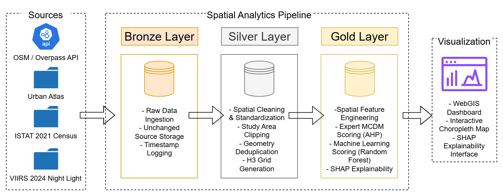

# Café Site Suitability — Milan · Geospatial ML Pipeline with Live WebGIS

[](https://mavilasantos.github.io/cafe-site-suitability-milan-geospatial-ml/)
[](LICENSE)

A reproducible spatial data pipeline that scores 971 hexagonal cells across Milan for café-retail viability, combining an expert-weighted scoring model with a trained classifier, an explainability layer, and a browser-based analytical frontend — built to compare how a rules-based approach and a data-driven approach converge (or don't) on the same real-estate question.

---

## Problem

Where should a café open in Milan? Two answers exist in practice and are rarely tested against each other: an **expert weighs criteria by hand** (foot traffic, transit access, competition), or a **model learns from where cafés already are**. This project builds both, on the same 971-cell spatial grid, from the same 13 engineered features — then uses SHAP to check whether the two methods actually agree on *why* a location works, not just *which* locations score well.

They partially agree on outcomes (cell-level rank correlation ρ = 0.79) and disagree on drivers (feature-importance correlation ρ = −0.41, not statistically significant) — the expert model over-weights transit accessibility; the trained classifier is driven far more by local café density and retail diversity. Both findings are stress-tested with 10,000-iteration permutation nulls before being trusted.

---

## Architecture



The pipeline runs as 8 sequential notebooks organized into three processing stages (raw ingestion → cleaned/standardized → modeled/scored), followed by a static frontend that reads the final output directly — no database, no backend server, no build step.

```
OSM Overpass API · Urban Atlas 2021 · ISTAT Census · VIIRS Night-Lights
        │
        ▼
  STAGE 1 — RAW INGESTION
  osmnx pulls + static raster/vector uploads, saved as-received
        │
        ▼
  STAGE 2 — CLEANED & STANDARDIZED
  CRS reprojection · spatial dedup (STRtree + union-find) · H3 grid
  generation · viability filtering → 971-cell spatial backbone
        │
        ▼
  STAGE 3 — FEATURES & MODELS
  13 spatial features → parallel scoring:
    Analytic Hierarchy Process (expert weights, eigenvector method)
    Random Forest classifier (AUC 0.951, group-aware CV)
        → SHAP TreeExplainer reconciles the two
        → GeoJSON export with per-cell explainability vectors
        │
        ▼
  WEBGIS FRONTEND (static, client-side, Leaflet)
  Choropleth + ranking + per-cell SHAP breakdown, served directly
  from the exported GeoJSON — reads Gold-layer output, nothing else
```

---

## Tech Stack

| Technology | Role |
|---|---|
| **Python / Jupyter (Google Colab)** | Pipeline execution environment across all three stages |
| **GeoPandas / Shapely** | Vector spatial operations — clipping, dissolve, buffering, CRS transforms |
| **H3 (Uber)** | Hexagonal discrete global grid — resolution 9, ~0.1 km²/cell, 971 viable cells |
| **OSMnx** | OpenStreetMap extraction — café POIs, transit stops, walking network, general POIs |
| **NetworkX** | Directed graph construction and betweenness centrality on the 86K-node pedestrian network |
| **Rasterio** | VIIRS night-light raster sampling for economic activity proxy |
| **scikit-learn** | Random Forest classifier, MinMax scaling, GroupShuffleSplit / StratifiedGroupKFold |
| **SHAP** | TreeExplainer — per-cell, per-feature signed attribution for the RF model |
| **NumPy / SciPy** | AHP eigenvector weight derivation, Spearman/Kendall correlation, permutation testing |
| **STRtree (Shapely)** | Spatial indexing for point deduplication and radius-based feature counts at scale |
| **Leaflet.js** | Client-side interactive choropleth map, no server-side rendering |
| **Vanilla JS / HTML / CSS** | WebGIS frontend — zero build step, zero framework, three static files |

---

## Pipeline Overview

This pipeline prioritizes full control over geometry operations, reproducibility, and explainability at every stage over orchestration infrastructure — appropriate for a research-grade methodology build rather than a scheduled production feed. Each notebook enforces its own reproducibility contract: hard-coded seeds, asserted CRS states, cardinality guards, and a canonical train/validation split saved once and never recomputed.

### Stage-by-stage

```
BRONZE — Raw Ingestion (01)
  OSM Overpass queries (cafés, transit ×4, walking network, general POIs)
  + static uploads (Urban Atlas FlatGeobuf, ISTAT shapefile, VIIRS GeoTIFF)
  saved exactly as received, zero transformation
  → 2,014 cafés · 15,136 transit stops (raw) · 114K road nodes · 337K road
    edges · 60,271 POIs

SILVER — Cleaning & Standardization (02–03)
  Geometry normalization (polygons → centroids) · CRS reprojection to
  EPSG:32632 · spatial clip to study boundary · STRtree+union-find
  deduplication (5m threshold) · areal population apportionment ·
  binary Urban Atlas land-use viability filter
  → H3 resolution-9 grid generated, viability-filtered (20% overlap
    threshold, sensitivity-tested) → 971 viable cells from 1,743 total
  → binary label derived: ≥2 cafés per cell = positive class (35.5%
    positive rate)

GOLD — Features, Scoring, Explainability (04–08)
  13 engineered features across 4 clusters (Accessibility, Demand
  Potential, Urban Context, Competition) — betweenness centrality,
  transit/POI radius counts, population density via areal apportionment,
  night-light sampling, H3 ring-based retail density
  → AHP: 4×4 pairwise comparison matrix, eigenvector method,
    Consistency Ratio 0.0175 (Saaty-valid)
  → Random Forest: 200 trees, group-aware split on H3 res-7 parents to
    limit spatial leakage, validation AUC 0.951
  → SHAP: TreeExplainer on validation set, additivity-checked
    (max error 0.005), feature-vs-AHP comparison run through a
    10,000-permutation null before any convergence claim is trusted
  → flat GeoJSON assembled: cross-join validated across all upstream
    Gold files, tier-classified, rounded, exported (971 cells × 29
    fields, 1.16 MB)
```

### Key Engineering Decisions

- **Spatial deduplication at scale without O(n²):** café and transit-stop dedup uses buffered-point STRtree queries feeding a union-find structure — O(n log n) and order-independent, replacing a naive pairwise comparison that doesn't scale past a few thousand points. Transit stops additionally resolve type conflicts by priority (metro > bus/tram > platform > bus_stop) within each merged component.

- **Population by areal apportionment, not centroid join:** ISTAT census population is distributed to clipped tract fragments in proportion to intersection area against the *original* (pre-clip) tract area — avoiding the double-counting that a naive post-clip-area denominator would introduce on boundary tracts.

- **Betweenness centrality validated for reproducibility, not just computed:** approximate betweenness (k=500 samples) is compared against a k=1000 run via Spearman rank correlation, hard-gated at ρ ≥ 0.99 before being trusted — a cheap approximation is only used once it's shown not to be noisy.

- **Split before scale, always:** the train/validation split (75/25, grouped by H3 resolution-7 parent cell to reduce adjacent-cell leakage) happens *before* any MinMaxScaler is fit, and the scaler is fit on training rows only. The split indices are pickled once and every downstream notebook loads that file rather than recomputing — one canonical partition, referenced everywhere.

- **Two scoring methods, deliberately never let to influence each other:** the AHP notebook and the Random Forest notebook both read from the same normalized feature table but write to separate output files; nothing about the RF model informs the AHP weights or vice versa. Convergence or divergence between them is measured after the fact, not engineered in.

- **No agreement claim ships without a null test:** both the cell-level AHP-vs-RF correlation (ρ = 0.79) and the feature-level AHP-vs-SHAP correlation (ρ = −0.41) are checked against a 10,000-iteration permutation distribution before being reported. The cell-level figure does *not* clear its 95th-percentile null threshold — meaning some of that apparent agreement likely reflects shared spatial autocorrelation rather than independent methodological convergence, and the project says so rather than overstating the result.

- **Delivery layer has no write path back into the pipeline:** the WebGIS is intentionally read-only — three static files (`index.html`, `app.js`, `styles.css`) that `fetch()` the final exported GeoJSON and summary JSON directly. No backend, no database, no build step; a local HTTP server is required only to satisfy the browser's same-origin policy.

---

## Results

| Metric | Value |
|---|---|
| H3 cells analyzed (resolution 9) | 971 viable / 1,743 total |
| Café POIs ingested → deduplicated | 2,014 → 1,728 |
| Road network scale | 337,620 edges, 114,046 nodes (86,043 post-filter) |
| General POIs ingested | 60,271 |
| Positive class rate (≥2 cafés/cell) | 35.5% |
| Random Forest validation AUC | 0.9510 |
| Random Forest cross-validation AUC | 0.9462 ± 0.0211 |
| AHP Consistency Ratio | 0.0175 (Saaty threshold: < 0.10) |
| AHP vs. RF agreement (cell-level, Spearman ρ) | 0.7937 — **does not clear permutation null (p95=0.85)** |
| AHP vs. SHAP agreement (feature-level, Spearman ρ) | −0.4073 — **null result** (permutation p = 0.24) |
| Top RF driver | Local café density (agglomeration signal) |
| Top AHP driver | Public transport accessibility |

The headline finding isn't that one method "wins" — it's that a 79% cell-level rank agreement can *look* like methodological convergence while a feature-level check reveals the two models are relying on almost opposite signals, and neither agreement figure survives a proper randomization test at full strength. That gap between surface-level and mechanism-level agreement is the reason this pipeline computes SHAP at all rather than stopping at the AHP/RF score comparison.

---

## Live Demo

The scored 971-cell grid is served through a static WebGIS — choropleth map, tier filtering, top-ranked cell browser, and a full per-cell signed SHAP breakdown for every location.

**[→ Launch the WebGIS](https://mavilasantos.github.io/cafe-site-suitability-milan-geospatial-ml/)** 

## Setup & Run

### Prerequisites

- Python 3.10+ with Jupyter (or Google Colab, which the notebooks were built against)
- Google Drive mount (notebooks read/write to `/content/drive/MyDrive/...` — adjust paths if running locally)
- ~500 MB free space for raw OSM extracts and the VIIRS raster

### Install dependencies

```bash
pip install -r requirements.txt
```

### Run the pipeline

Notebooks are numbered and must run in order — each stage's completion check gates the next:

```
pipeline/bronze/01_Environment_Setup_and_Data_Ingestion.ipynb
pipeline/silver/02_Cleaning_and_Standardization.ipynb
pipeline/silver/03_H3_Grid_Generation_and_Spatial_Backbone.ipynb
pipeline/gold/04_Feature_Engineering.ipynb
pipeline/gold/05_AHP_Scoring.ipynb
pipeline/gold/06_Random_Forest_Training_and_Validation.ipynb
pipeline/gold/07_SHAP_Computation_and_AHP_vs_SHAP_Comparison.ipynb
pipeline/gold/08_GeoJSON_Export_and_WebGIS_Preparation.ipynb
```

Two manual uploads are required before Notebook 01 will pass its completeness check: the Urban Atlas 2021 FlatGeobuf (Copernicus) and the ISTAT 2021 census shapefile — both are too large/licensed to bundle in-repo. VIIRS VNL v2.2 is also expected as a static upload.

### Serve the results

```bash
cd webgis/
python -m http.server 8080
```

---

## Repository Structure

```
cafe-site-suitability-milan-geospatial-ml/
├── .gitignore
├── LICENSE
├── README.md
├── requirements.txt
├── .github/
│   └── workflows/
│       └── deploy-pages.yml
├── assets/
│   └── architecture_diagram.png
├── pipeline/
│   ├── bronze/     → raw ingestion notebook
│   ├── silver/     → cleaning, H3 grid generation
│   └── gold/       → features, AHP, RF, SHAP, WebGIS export
└── webgis/
    ├── index.html
    ├── app.js
    ├── styles.css
    └── data/
        ├── phase1/  → earlier 3-Municipio sample run
        └── phase2/  → canonical 9-Municipio results (current)
```

---

## Author

**Miguel Angel Avila Santos**

[](https://linkedin.com/in/mavilasantos)
[](https://github.com/mavilasantos)
